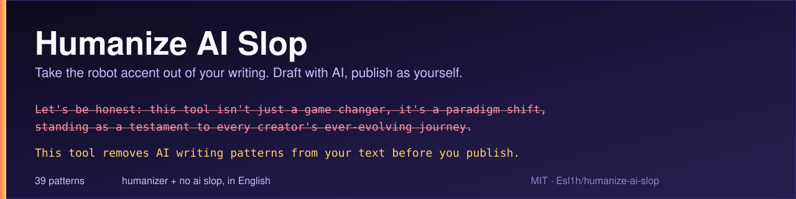

<p align="center">
  
</p>

<p align="center">
  <a href="LICENSE"></a>
  <a href="#the-41-patterns"></a>
  <a href="https://github.com/Esl1h/humanize-ai-slop/stargazers"></a>
  <a href="https://github.com/Esl1h/humanize-ai-slop/network/members"></a>
</p>

# Humanize AI Slop

Humanize AI Slop rewrites AI-sounding text so it reads like a person wrote it, without changing what it says. It merges two of the most used writing skills for this job, [Humanizer](https://github.com/blader/humanizer) and [No AI Slop](https://github.com/petergyang/no-ai-slop), into one English skill of 41 patterns, following the layout of [Humanize BR](https://github.com/Esl1h/humanize-br), which did the same merge for Brazilian Portuguese. Because it is just Markdown, it works with any agent that supports skills: Claude Code, ChatGPT, Codex, and others.

## The problem

Each of the two source skills is good at something the other skips. Humanizer, built on Wikipedia's ["Signs of AI writing"](https://en.wikipedia.org/wiki/Wikipedia:Signs_of_AI_writing), is strong on encyclopedic tells: inflated importance, vague sources, sales language, chatbot leftovers, emoji, bold, dashes. No AI Slop is strong on the rhetoric of blog posts and social media: binary contrasts, throat-clearing openers, faux-insight setups, colon reveals, fake-profound endings, and the editing principles that keep a rewrite from flattening the writer's voice. Running both means two installs, two numbering schemes, and two sets of rules that sometimes overlap.

This skill puts the two lists together, dedupes the overlap, keeps one numbered list, and adds No AI Slop's detect mode and self-check list on top of Humanizer's voice matching and no-invented-facts rule. Humanize BR proved the merge works in Portuguese; this is the English version.

## The two modes

**Edit (default).** You send a text, the skill returns the edited version plus a **What changed** section.

```
/humanize-ai-slop

I recently spent five unforgettable days in Lisbon, and let me tell you —
this city completely stole my heart...
```

**Detect.** You ask whether a text sounds like AI. The skill names every pattern it finds, quotes the line, and suggests the fix, without rewriting anything and without giving an "AI percentage" (that number does not really exist).

```
/humanize-ai-slop is this AI? [paste the text here]
```

Or ask in plain language:

```
Humanize this text for me: [your text]
```

```
Does this read like ChatGPT wrote it?
```

To edit a whole file, give its path:

```
Take the robot accent out of the prose in docs/launch-post.md
```

### Match your voice

If you want the rewrite to sound more like you, include a sample:

```
/humanize-ai-slop

Here's a sample of my writing for voice matching:
[paste 2 or 3 paragraphs of your own writing]

Now humanize this text:
[paste the AI text here]
```

The skill follows the sample's rhythm, word choice, punctuation, and deliberate quirks, including how often you use em dashes, and it stops treating pattern 15 as a ban when the sample already uses them.

## Installation

**With the Skills CLI**, in Claude Code, ChatGPT, Codex, or any compatible agent:

```bash
npx skills add Esl1h/humanize-ai-slop --global
```

Leave off `--global` to install only in the current project. Add `--agent <name>` or `--agent '*'` to choose which agents receive the skill.

**As a Claude Code plugin:**

```text
/plugin marketplace add Esl1h/humanize-ai-slop
/plugin install humanize-ai-slop@humanize-ai-slop
```

The plugin command is `/humanize-ai-slop:humanize-ai-slop`.

**In ChatGPT or Codex**, paste this into the conversation:

```text
Install the /humanize-ai-slop skill globally from
https://github.com/Esl1h/humanize-ai-slop
```

**In Claude Desktop**, download this repository as a ZIP and upload it as a skill.

**Manual install:** copy `SKILL.md` and `eval.md` into your agent's skill folder, plus `scripts/` if you want the mechanical scanner.

## The mechanical scanner

The repo bundles `scripts/slop_scan.py`, a dependency-free scanner for the checks a machine can make: banned words, em and en dashes, decorated headings, mixed quote styles, bold-label lists, and stacked hyphen pairs. It reads its word lists from `SKILL.md`, so it never drifts from the skill. The rhetorical patterns still need the model.

```bash
python3 scripts/slop_scan.py docs/launch-post.md   # list findings with pattern numbers
python3 scripts/slop_scan.py - < draft.txt         # scan stdin
python3 scripts/slop_scan.py clean.md --strict     # exit 1 on any finding
```

The skill runs the scanner in detect mode and after file edits whenever it is installed with the repo.

## Tests

`evals/` holds fixtures with planted patterns, golden rewrites, and a grader:

```bash
python3 evals/run_evals.py                                          # self-checks (CI)
python3 evals/run_evals.py --grade evals/fixtures/shellmate.md out.md
```

`evals/evals.json` lists prompts and assertions for running the full skill with an agent. CI runs the self-checks on every push.

## The 41 patterns

### Content patterns

| # | Pattern | Before | After |
|---|---------|--------|-------|
| 1 | **Inflated importance and legacy** | "marking a pivotal moment in the evolution of..." | "was established in 1989 as part of a wider decentralization" |
| 2 | **Name-dropping to prove importance** | "cited in NYT, BBC, FT, and The Hindu, 500,000 followers" | Keep only the citation that gives real context |
| 3 | **Shallow -ing analysis** | "symbolizing... reflecting... showcasing..." | Keep only what the source supports |
| 4 | **Sales language** | "nestled within the breathtaking region" | "is a town in the Gonder region" |
| 5 | **Vague sources and weasel attribution** | "experts believe it plays a crucial role" | Name a real source or remove the claim |
| 6 | **Vague connection or association** | "is associated with", "in connection with" | Name the relationship the source gives |
| 7 | **Formulaic challenges and outlook** | "despite challenges... continues to thrive" | Keep the facts, drop the pitch |

### Language and grammar patterns

| # | Pattern | Before | After |
|---|---------|--------|-------|
| 8 | **Overused AI words** | "additionally... enduring testament... culinary landscape" | "also... remain common" |
| 9 | **Avoiding is, are, and has** | "serves as... features... boasts" | "is... has" |
| 10 | **Not X but Y, binary contrasts, negative listing** | "It's not just a song, it's a statement" / "Not a X. Not a Y. A Z." | State the point directly |
| 11 | **Forced groups of three** | "innovation, inspiration, and insights" | Use the number of items the meaning needs |
| 12 | **Synonym cycling and repeated openings** | "the agent... the assistant... the tool" | Use one name for the same subject |
| 13 | **False from X to Y ranges** | "from the Big Bang to dark matter" | List the topics directly |
| 14 | **Passive voice and missing subjects** | "No configuration file needed" | "You do not need a configuration file" |

### Style and formatting patterns

| # | Pattern | Before | After |
|---|---------|--------|-------|
| 15 | **Em and en dashes** | "institutions—not the people—yet this continues—" | Periods, commas, colons, or parentheses |
| 16 | **Too much bold text** | "**OKRs**, **KPIs**, **BMC**" | "OKRs, KPIs, BMC" |
| 17 | **Lists with bold mini-headings** | "**Performance:** Performance improved" | Use prose when a list adds no value |
| 18 | **Title case in headings** | "## Strategic Negotiations And Partnerships" | "## Strategic negotiations and partnerships" |
| 19 | **Emojis** | "🚀 Launch Phase: 💡 Key Insight:" | Remove the emojis |
| 20 | **Curly quotes and mixed quote styles** | `said “the project”` mixed with `said "the"` | Match the writer or target format, and stay consistent |

### Chatbot patterns

| # | Pattern | Before | After |
|---|---------|--------|-------|
| 21 | **Chatbot text left in the answer** | "I hope this helps! Let me know if..." | Remove it |
| 22 | **Knowledge-limit disclaimers and guesses** | "while details are limited... it appears to have been..." | State what the source shows, or remove the claim |
| 23 | **Overly agreeable tone** | "Great question! You're absolutely right!" | Answer directly |
| 24 | **Re-explaining what the reader knows** | reply that rebuilds the thread's context before the decision | Lead with the decision |

### Filler, hedging, and endings

| # | Pattern | Before | After |
|---|---------|--------|-------|
| 25 | **Filler phrases** | "in order to", "due to the fact that" | "to", "because" |
| 26 | **Too many qualifiers** | "could potentially possibly" | "may" |
| 27 | **Generic positive endings and summary recaps** | "The future looks bright... In conclusion..." | End on the last concrete fact |

### Hyphenation

| # | Pattern | Before | After |
|---|---------|--------|-------|
| 28 | **Too many hyphenated word pairs** | "customer-centric, data-driven, state-of-the-art" | Keep only the hyphens grammar needs |

### Fake depth and rhetoric

| # | Pattern | Before | After |
|---|---------|--------|-------|
| 29 | **Pretending to reveal a deeper truth** | "at its core, what really matters is..." | State the point directly |
| 30 | **Announcing the next point and rhetorical setups** | "let's dive in", "what if I told you..." | Start with the content |
| 31 | **A heading repeated below itself** | "## Performance" + "Speed matters." | Let the heading do the work |
| 32 | **Writing about the document instead of its subject** | "was added to replace...", "the table below compares" | Describe the subject, not the document |
| 33 | **Forced punchlines, fragments, robotic rhythm** | "No preference. No prior. No nostalgia." | Use natural sentence lengths |
| 34 | **Formulaic sayings and fake-profound kickers** | "The future isn't coming. It's already here." | Delete it, end on the last concrete sentence |
| 35 | **Fake-candid and throat-clearing openers** | "Honestly? Here's the thing..." | State the answer directly |
| 36 | **Answering objections no one raised** | "I'm not saying... but..." | Remove the unsupported defense |
| 37 | **Rejecting fake alternatives** | "A tempting option would be..., but" | State the real constraint |
| 38 | **Colon reveals** | "The detail that makes it work: a separate agent" | Rewrite as a plain sentence |
| 39 | **Interpretive metadiscourse** | "That last part matters more than it sounds" | Delete the aside |
| 40 | **Formatting slop** | emoji headings, decorative bold, bullets for two sentences | Format follows the content |
| 41 | **Faux-insight setups** | "Here's what nobody tells you: ..." | Cut the setup, keep the claim |

Every pattern has a full example, its caveats, and an explanation in [`SKILL.md`](SKILL.md). The self-check list the skill runs on its own work is in [`eval.md`](eval.md).

## Full example

*Claims without support, such as a startup-time improvement with no number behind it, are kept as plain claims or flagged for the writer. They are never filled in with an invented figure.*

**Before (AI-sounding):**
> Let's be honest: most developers don't think about their terminal until it breaks. But here's what nobody tells you — the terminal isn't just a tool, it's the foundation of your entire workflow.
>
> Today we're thrilled to announce **Shellmate 2.0**, a groundbreaking update that marks a pivotal moment in our journey. 🚀 Nestled at the intersection of speed, simplicity, and power, Shellmate 2.0 stands as a testament to our unwavering commitment to developer experience.
>
> Here's what's new:
> - **⚡ Performance:** Startup time has been dramatically improved through cutting-edge optimizations.
> - **🎨 Themes:** A vibrant new theme engine lets you craft a truly personalized experience.
> - **🔌 Plugins:** A robust plugin API empowers the community to extend Shellmate in ways we never imagined.
>
> Industry experts agree that developer tooling is entering a new era, and Shellmate is leading the charge. The detail that makes it all work: a rewritten renderer that leverages GPU acceleration, ensuring buttery-smooth scrolling even in massive log files.
>
> This isn't just an update. It's a paradigm shift. Not a patch. Not a refresh. A reinvention.
>
> Despite the challenges of maintaining an open-source project, Shellmate continues to thrive thanks to its passionate community. The future of the terminal isn't coming. It's already here.
>
> I hope you enjoy this release! Let me know if you'd like a deeper dive into any feature. ✨

**Patterns found:** 35 (fake-candid opener: "Let's be honest:"), 41 (faux-insight setup: "here's what nobody tells you"), 15 (em dash), 10 (binary contrast: "isn't just a tool, it's"; "This isn't just an update. It's a paradigm shift."; negative listing: "Not a patch. Not a refresh. A reinvention."), 1 (inflated importance: "marks a pivotal moment", "stands as a testament"), 8 (overused words: "groundbreaking", "journey", "vibrant", "robust", "leverages", "empowers"), 4 (sales language: "nestled at the intersection", "unwavering commitment"), 19 (emojis 🚀 ⚡ 🎨 🔌 ✨), 16 and 17 (bold and bold mini-heading list), 30 (announcing: "Here's what's new:"), 14 (passive voice: "Startup time has been dramatically improved"), 5 (weasel attribution: "Industry experts agree"), 38 (colon reveal: "The detail that makes it all work:"), 3 (shallow -ing: "ensuring buttery-smooth scrolling"), 33 (dramatic fragments), 7 (formulaic challenges: "Despite the challenges... continues to thrive"), 34 (fake-profound kicker: "The future of the terminal isn't coming. It's already here."), 21 (chatbot leftover: "I hope you enjoy this release! Let me know..."), plus the banned words "cutting-edge" and "paradigm shift".

**After:**
> Shellmate 2.0 is out. It starts faster, ships a new theme engine, and adds a plugin API.
>
> The biggest change is under the hood. We rewrote the renderer to use the GPU, so scrolling stays smooth even in large log files. Startup is faster as well.
>
> The theme engine replaces the old color settings with full themes you can write and share. The plugin API lets the community add features without forking the project.
>
> Shellmate is open source and maintained by its contributors.

**What changed:** we cut every unsupported claim ("industry experts agree", "leading the charge", "in ways we never imagined") instead of inventing a source for it. "Dramatically improved" startup time became "faster" because the draft gives no number; the writer should add the measurement if there is one. The bold emoji list became prose, the openers, the colon reveal, the fragment run, the kicker, and the chatbot sign-off are gone, and the text ends on the last concrete fact instead of a send-off. Every feature in the original (faster startup, theme engine, plugin API, GPU renderer, smooth scrolling in large logs, open source, community) is still there. Nothing was added.

## Where this comes from

Humanize AI Slop does not start from scratch. It is the merge of two MIT skills in English, arranged the way Humanize BR arranged them for Portuguese. See [`NOTICE.md`](NOTICE.md) for the original copyright notices.

| | Humanizer | No AI Slop | Humanize BR | Humanize AI Slop |
|---|---|---|---|---|
| Language | English | English | Brazilian Portuguese | English |
| Patterns | 35 | 20+ | 41 | 41 |
| Detect mode (no rewrite) | No | Yes | Yes | Yes |
| Explicit editing principles | Partial | Yes | Yes | Yes |
| Voice matching from a sample | Yes | No | Yes | Yes |
| Self-check list (`eval.md`) | No | Yes | Yes | Yes |
| Hyphenation and quote rules | Yes | Partial | Adapted for Portuguese | Yes |
| Claude Code plugin | Yes | No | Yes | Yes |
| ChatGPT / Codex plugin | No | Yes | Yes | Yes |

Three repositories inspired this one:

- [Humanizer](https://github.com/blader/humanizer), by Siqi Chen, for the 35 Wikipedia-based patterns, the voice matching, and the no-invented-facts rule. Its later v3 revisions contributed the vague-association and wrong-reader patterns.
- [No AI Slop](https://github.com/petergyang/no-ai-slop), by Peter Yang, for the editing principles, the detect mode, the word lists, the self-check, and the rhetorical patterns.
- [Humanize BR](https://github.com/Esl1h/humanize-br), for the idea of merging the two into one numbered list and for the repository layout this one copies.

## Contributing

Suggestions for new patterns, better examples, and false-positive reports are welcome. Read [`AGENTS.md`](AGENTS.md) before editing `SKILL.md`, and run `python3 scripts/validate-package.py` before opening a pull request. See also [`CONTRIBUTING.md`](CONTRIBUTING.md).

If this skill saved you some work, leave a star. It helps other people find the tool.

## Star history

<a href="https://star-history.com/#Esl1h/humanize-ai-slop&Date">
  
</a>

## Version history

<details>
<summary>Show release notes</summary>

- **1.1.0** - Adds two patterns from later Humanizer revisions, vague association and re-explaining what the reader knows, widens writing about the document and formatting slop, and renumbers the catalog to 41 patterns. Adds a defined detect report format, a pattern index in SKILL.md, a mechanical scanner (`scripts/slop_scan.py`), and an eval suite (`evals/`).
- **1.0.0** - First release. Merges Humanizer (35 patterns) and No AI Slop (20+ patterns) into one English skill of 39 patterns, with a detect mode that does not rewrite, voice matching from a writing sample, a self-check list, and plugins for Claude Code and ChatGPT/Codex. Layout follows Humanize BR.

</details>

## License

MIT. See [`LICENSE`](LICENSE) and [`NOTICE.md`](NOTICE.md) for the copyright notices of the original projects.
